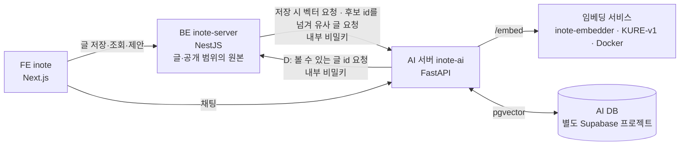

# KURE 임베딩 활용 — 기획·설계 (inote)

> 한국어 임베딩 모델 **KURE-v1**으로 내 글 사이의 "뜻이 비슷함"을 계산해서 관련 글 추천·카테고리 제안·중복 알림·내 글 기반 AI 답변(RAG)을 만든다.
> 상태: ✅ **방향 승인(2026-10-12)** — 실험은 별도 임시 레포 `inote-embedder`, 로컬 DB는 도커 분리, **벡터는 AI DB가 소유하고 공개 여부는 BE가 판정(11번, 같은 날 BE 소유에서 변경 확정)**, **A1~A3 완료**, 다음은 A4(AI DB 테이블) · 작성자: Claude Code
> 이 문서는 **한 단계씩** 구현한다. 아키텍처·UX는 AI가 임의로 정하지 않는다 → 아래 **「10. 결정과 미결정」**에서 아직 열려 있는 항목은 풀리기 전에는 해당 부분을 구현하지 않는다.
> 관련 레포: `inote`(FE) · `inote-server`(BE, 글·공개 범위의 원본) · `inote-ai`(AI 서버, **벡터 소유**) · **`inote-embedder`(임시 실험 레포: 임베딩 서비스·로컬 DB·평가)**
> **이어서 작업할 때는 [`HANDOFF.md`](HANDOFF.md)를 먼저 읽는다** (4개 레포의 현재 상태·로컬 실행법·다음 할 일·함정).

---

## 0. 한눈에

| 단계 | 내용 | 성격 | 선행 |
|---|---|---|---|
| **A. 기반** | 도커로 KURE 띄우기, **AI DB에 벡터 저장(pgvector)**, 글 저장 시 BE→AI→임베딩, 기존 글 일괄 계산, 공개 범위 규칙 | 보이지 않는 배관 | — |
| **B. 관련 글 추천** | 글 상세 하단 "비슷한 글" | 첫 눈에 보이는 결과 | A |
| **C. 카테고리 제안 · 유사 글 알림** | 글 저장·작성 중에 비슷한 글들의 카테고리를 제안, 비슷한 글이 있으면 알림 | 쓰는 중 모델을 불러야 함 | B |
| **D. 내 글 기반 답변 (RAG)** | AI 어시스턴트가 내 글을 찾아 출처와 함께 답변 | 가장 크고 위험 | C, 그리고 **AI 서버 요청자 검증(보안 과제)** |

**이 순서인 이유**: B·C는 모두 "어떤 글(또는 쓰는 중인 글)과 가장 비슷한 내 글 몇 개"라는 **같은 조회** 위에 있다. B를 만들면 C는 얇은 층만 더하면 된다. D는 글을 문단 단위로 쪼개고 LLM과 연결하는 별개의 큰 작업이라 앞 단계로 검증된 배관 위에서 한다. 검색(키워드→의미)은 D의 부산물이라 따로 만들지 않는다.

---

## 1. 배경과 목표

- 내 글이 쌓일수록 "전에 쓴 글을 다시 찾기·연결하기"가 어려워진다. 현재는 글자 일치 검색뿐이다.
- AI 어시스턴트는 내 글을 모른다 — 대화만 LLM에 보낸다.
- **목표**
  1. 글끼리 뜻으로 연결한다 (관련 글, 중복 감지).
  2. 글을 저장할 때 카테고리를 고르는 수고를 줄인다.
  3. AI 어시스턴트가 내 글을 근거로 답한다.
  4. (학습·포트폴리오) 한국어 임베딩·RAG를 **직접 측정해서** 고른 과정과 결과를 남긴다 — 감이 아니라 평가 세트로 기준을 정한다.
- 규모 현실: 공개 글이 약 20개뿐이라 서비스 가치보다 **설계·측정 경험의 가치**가 크다. 그래서 평가 계획(7절)을 기능만큼 중요하게 본다.

## 2. 현재 상태 (코드에서 확인한 사실)

| 항목 | 현재 |
|---|---|
| 글 저장 | BE(`inote-server`)의 `Post` — 본문 `content`는 **HTML**, `isPrivate`, `publishedAt`(null이면 draft), 카테고리는 이름 문자열 `category` + 트리(`PostCategory`) |
| 글 검색 | 제목·본문 글자 일치(대소문자 무시)만 |
| AI 채팅 | `inote-ai/app/routers/chat.py` — LLM(`openai/gpt-oss-20b`)에 시스템 프롬프트+대화만 전달. 글 본문·다른 글은 참조하지 않는다 (`post_id`·제목·카테고리는 저장·권한용) |
| 도구 호출 | `reading_chat.py`가 이미 OpenAI 방식 `tools`/`tool_choice="auto"`를 씀(`book_tools.py`) → D의 RAG를 **같은 방식의 도구**로 붙일 수 있다 |
| DB | **BE DB와 AI DB가 별개 Supabase 프로젝트.** 글·사용자는 BE DB. **AI DB**(`inote-ai` 프로젝트, Transaction pooler 6543)에는 `conversation_sessions`·`conversations`가 있고 `schema.sql`로 만든다(마이그레이션 도구 없음). 모든 `public` 테이블에 **RLS 활성화**. AI 서버는 서버리스라 요청마다 연결을 열고 닫는다(`prepare_threshold=None`) |
| 외부 호출 패턴 | BE→AI는 `x-internal-secret` 헤더, 요약은 **글 저장 뒤 AI에 글 제목·본문을 보내는**, **실패해도 글 저장은 막지 않는(fail-open)** 패턴. 글 삭제 때도 AI에 세션 삭제를 요청한다 |
| 로컬 환경 | **로컬 BE와 운영 BE가 같은 Supabase DB를 쓴다**(dev/prod 분리 없음). Docker Desktop **4.94.0 설치·확인됨**(2026-10-12). 이 PC는 **Intel Mac(x86_64)**, 컨테이너 자원 CPU 12 · 메모리 약 7.75GB, GPU 가속 없음(CPU 추론). 터미널 `docker` PATH 연결은 확인 필요(앱 안 실행 파일로는 동작) |
| 임베딩·벡터 코드 | 서비스 레포에는 없음. 실험 레포 `inote-embedder`에 임베딩 서비스와 로컬 실험(A2·A3)이 있다 |

## 3. 범위

**포함**: A~D 및 평가 세트.
**제외(이 문서에서는 다루지 않음)**: 이미지·표 의미 이해, 다국어 글, 사용자별 개인화 랭킹, 벡터 DB 전용 서비스(Pinecone 등) 도입, 모바일 앱 연동, 독서 기록과의 연결(후속 후보).

---

## 4. 전체 구조



- **임베딩 서비스**: 텍스트 → 벡터만 하는 작은 서비스. 모델이 커서(수백 M 파라미터) 별도로 둔다. **호출하는 쪽은 AI 서버뿐**이다(BE는 임베딩 서비스를 모른다).
- **AI 서버가 벡터를 소유**한다: AI 관련 데이터를 AI 서버·AI DB에 모으고, 운영 DB(BE)에는 새 확장·테이블을 추가하지 않는다.
- **공개 여부는 BE가 판정한다 — 핵심 원칙.** AI DB에는 글의 공개 여부·작성자를 **복사해 두지 않는다**(동기화가 어긋나면 비공개 글이 새므로). BE가 "이 요청자가 볼 수 있는 글 id 목록"을 정해서 AI에 넘기면, AI는 **그 목록 안에서만** 순위를 매겨 돌려준다 → AI가 후보 밖의 글을 돌려주는 것이 구조적으로 불가능하다.
- FE는 모델도 AI 서버의 벡터 API도 모른다. B·C는 BE API만 부른다.

---

## 5. 공통 설계

### 5.1 모델
- **KURE-v1** (`nlpai-lab/KURE-v1`): 한국어 검색용으로 `BAAI/bge-m3`를 한국어 데이터로 미세조정한 임베딩 모델.
- **모델 카드로 확인됨(2026-10-12)**: 차원 **1024**, 최대 입력 **8192**, 라이선스 **MIT**, 접두어 언급 없음, 정규화 여부 언급 없음 → 서비스가 직접 정규화한다.
- 모델 이름·버전은 **DB에 같이 저장**한다(5.3) → 나중에 모델을 바꾸면 이전 벡터와 섞이지 않고 다시 계산할 대상을 알 수 있다.

### 5.2 임베딩 서비스 (embedder)

**계약 (구현·측정 완료, `inote-embedder` 레포)**
```
POST /embed          헤더: x-internal-secret
  요청  { "inputs": ["문장1", "문장2"] }        # 1~16개, 각 최대 8,000자
  응답  { "model": "nlpai-lab/KURE-v1", "dim": 1024, "embeddings": [[...], [...]] }   # 정규화된 벡터
GET  /health         → { "status": "ok", "model": "...", "dim": 1024 }
```
- 인증은 기존 방식(`x-internal-secret`). `INTERNAL_SECRET`이 없으면 `/embed`는 503.
- 환경 변수 `EMBEDDER_URL`이 **없거나 응답이 없으면 AI 서버는 임베딩 API를 503으로 거절하고, BE는 이를 무시한다**(글 저장은 정상, fail-open). 운영에 임베딩 서비스를 올리기 전에도 배포가 깨지지 않는다.
- 측정 결과(A2, `inote-embedder/docs/a2-results.md`): 이미지 약 427MB, 첫 시작 약 2분·재시작 약 15초, 메모리 약 0.9GB, 짧은 문장 약 0.36초, 긴 글(1,150자) 약 2.6초.

**구현 선택지**: 1안(FastAPI + `sentence-transformers`)으로 구현·검증 완료. TEI(Hugging Face 공식 이미지)는 필요해지면 비교한다.
- **코드 위치**: 임시 별도 레포 **`inote-embedder`**에서 실험한다. 서비스 레포에 영향을 주지 않고, **합칠지·어디에 둘지는 결과를 보고 다시 정한다.** `inote-ai`에 합칠 때는 하위 폴더로 두고 **`.vercelignore`에 추가가 필수**(Vercel의 Python 함수는 프로젝트 파일을 전부 번들에 넣는다), 루트 `requirements.txt`에 무거운 의존성을 넣지 않는다. 기존 FastAPI 앱(`app/`)에 `/embed`를 합치는 것은 번들 크기(비압축 500MB)·모델 로드 지연 때문에 불가.
- **Render 무료(512MB)·Vercel 서버리스에는 올릴 수 없다** (8절). AI 서버가 Vercel에서 도므로 **운영에서는 AI 서버가 인터넷으로 닿는 곳에 임베딩 서비스를 호스팅**해야 한다.

### 5.3 저장 — Postgres `pgvector` (**AI DB**)

`inote-ai`의 `schema.sql`에 추가한다 (AI DB는 마이그레이션 도구 없이 이 파일로 관리).
```sql
CREATE SCHEMA IF NOT EXISTS extensions;         -- Supabase 관례: 확장은 extensions 스키마에 설치 (로컬 DB에서도 같은 구조로 만든다)
CREATE EXTENSION IF NOT EXISTS vector WITH SCHEMA extensions;

create table if not exists post_embedding (
  post_id      text primary key,                  -- BE의 Post.id. 다른 DB라 외래 키는 없다
  model        text not null,                     -- 'nlpai-lab/KURE-v1'
  content_hash text not null,                     -- 임베딩한 텍스트의 해시: 같으면 다시 계산하지 않는다
  embedding    extensions.vector(1024) not null,  -- 차원 1024는 모델 카드로 확인됨
  embedded_at  timestamptz not null default now()
);
alter table post_embedding enable row level security;   -- 프로젝트 규칙: 모든 public 테이블 RLS 켬
```
- 글 하나에 벡터 하나(글 단위, 글 본문 텍스트는 저장하지 않는다). D에서 문단 단위 테이블(`post_chunk_embedding`)을 **따로** 추가한다(필요해질 때).
- **공개 여부·작성자·카테고리 같은 글 정보는 이 테이블에 없다.** 필요하면 BE가 알려 주고(후보 id), 결과의 글 정보는 BE가 붙인다.
- 거리는 **코사인**(`<=>`). 글이 수백 개 이하이면 **인덱스 없이 전체 비교**로 충분하다(정확하고 단순). 수천 개를 넘기면 HNSW 인덱스를 검토.
- 다른 DB라 글이 삭제돼도 자동으로 지워지지 않는다 → 삭제 연동(5.5)과 정리 스크립트가 필요하다. 남은 벡터(고아)가 있어도 **BE가 후보 id를 정하므로 노출되지 않는다.**
- **`vector` 확장은 AI Supabase 프로젝트에서 켠다**(Database → Extensions 또는 `create extension`). 무료 플랜 가능 여부는 문서에 언급이 없어 실제로 켤 때 확인한다.

### 5.4 임베딩할 텍스트 만들기
- 글 본문은 **BE가 AI 서버에 제목·HTML 본문으로 보내고**(요약 요청과 같은 방식), **AI 서버가 텍스트로 정리**한다(`inote-embedder/lab/textprep.py`의 로직을 이식).
- `제목 + 줄바꿈 + 본문 텍스트`: HTML 태그를 지우고 공백을 정리한 순수 텍스트(script·style 제외). 코드 블록은 일단 포함하되 길이 상한으로 자른다.
- **카테고리는 텍스트에 넣지 않는다** — C에서 카테고리를 예측하는데 정답이 입력에 섞이면 안 된다.
- 길이 상한은 처음엔 제목+앞부분 약 1,500자에서 시작해 측정으로 조정한다.
- 같은 텍스트면 같은 해시 → 재계산 생략.

### 5.5 갱신 정책
| 이벤트 | 동작 |
|---|---|
| 글 발행/재저장(`publish: true`) | 저장 응답은 막지 않고 **뒤에서** BE가 AI에 제목·본문을 보내 벡터를 갱신(실패하면 경고 로그만, fail-open). 해시가 같으면 생략 |
| 자동 임시저장 | 하지 않음 (draft는 대상 아님) |
| 공개↔비공개 전환 | **아무것도 하지 않는다.** 벡터에 공개 여부가 없고, 조회 때 BE가 후보 id를 정한다 |
| 글 삭제 | BE가 AI에 벡터 삭제를 요청(실패해도 삭제는 진행). 못 지운 고아 벡터는 후보 id에 없어 노출되지 않고, **정리 스크립트**가 BE의 글 id 목록과 비교해 지운다 |
| 모델 교체 | `model` 컬럼이 다른 행을 일괄 재계산 (백필 스크립트 재사용) |
| 기존 글 | **백필 스크립트**(BE 쪽, DB로 모든 발행 글을 읽어 AI에 전송)로 한 번에 계산 — 비공개 글도 포함(C가 본인 비공개 글을 쓴다) |

### 5.6 공개 범위 규칙 (가장 중요 — 어기면 비공개 글 유출)

**원칙: BE가 "볼 수 있는 글 id 목록(후보)"을 정하고, AI는 그 안에서만 순위를 매긴다.**

| 기능 | 후보(BE가 정함) |
|---|---|
| B 관련 글 (읽는 사람 화면) | 발행됨 **AND** (공개 **OR** 요청자 본인 글), 자기 자신 제외 — 글 상세 조회 규칙과 같다 |
| C 카테고리 제안·유사 글 알림 (쓰는 사람 화면) | **요청자 본인의 발행 글만**(비공개 포함), 수정 중인 글 제외. 남의 글은 쓰지 않는다 |
| D RAG | 게스트: 공개 글만 / 로그인: 공개 글 + 본인 글. AI가 BE에 "이 요청자가 볼 수 있는 글 id"를 물어 그 안에서만 검색한다. ⚠️ **AI 서버 요청자 검증(10번) 전에는 본인 비공개 글을 후보에 넣지 않는다** |

- 후보 계산은 **BE의 한 함수**에 모아서 B·C·D가 같은 걸 쓰게 한다 (흩어지면 하나가 빠진다).
- AI 서버는 공개 여부를 **모른다·판단하지 않는다.** 후보 밖의 id는 돌려줄 수 없다.
- 접근 불가 글은 응답에 **존재 자체를 드러내지 않는다**(제목·개수도 없음).
- **한계**: 후보 id 목록의 크기가 글 수에 비례한다(글 1,000개여도 수십 KB). 수천 개를 넘으면 "AI가 상위 N개를 돌려주고 BE가 거르는" 방식으로 바꾸는 것을 검토한다.

### 5.7 장애·성능
- 임베딩 서비스·AI 서버·AI DB 중 어느 것이 장애여도: B는 "비슷한 글" 영역을 숨기고, C는 제안을 숨기고, D는 도구 없이 일반 답변. **글쓰기·저장은 절대 막히지 않는다.**
- 쓰는 중 호출(C)은 입력이 멈춘 뒤에만(디바운스), 최소 글자 수, 이전 요청 취소, 서버 쪽 호출 빈도 제한. 호출 경로가 FE → BE → AI → 임베딩 서비스로 길어서 지연이 쌓인다(A에서 측정).
- **Vercel 함수 시간 제한**: AI 서버(Vercel)가 글 한 편을 임베딩하는 데 임베딩 서비스에서 약 3~8초(측정)가 걸린다. 함수 최대 실행 시간 설정·제한을 **확인해야 한다**(10번). 초과하면 그 글의 임베딩이 실패하므로 백필·재시도로 보완한다.

---

## 6. 단계별 설계

> 진행 규칙: **계약 → FE(유닛·MSW 테스트) → BE → 통합 확인**, 한 번에 한 작업, 끝날 때마다 보고. BE 테스트는 Claude가 목록·골격을 주고 사용자가 작성(미루면 spec 주석으로 남김).

### A. 기반
**목표**: 글이 벡터로 AI DB에 저장되고, BE가 후보 id를 넘겨 "가까운 이웃"을 조회할 수 있다. 화면 변화는 없다.

**도커가 하는 일 (두 가지)**
1. **임베딩 서비스 컨테이너** (KURE 서빙)
2. **로컬 개발용 Postgres + pgvector 컨테이너** — 새 테이블·확장은 로컬 DB에서 먼저 검증하고, 확인되면 운영(AI DB)에 적용한다. **`inote-ai` 개발용 DB**로 쓴다(위치는 10번 12). 로컬 DB에는 **공개 글만** 넣는다(비공개 글을 복사하지 않는다).

**작업**
| # | 작업 | 담당 |
|---|---|---|
| A1 | ✅ Docker Desktop 설치·확인 (2026-10-12: 4.94.0, Intel Mac, 배정 CPU 12·메모리 7.75GB) | 사용자·Claude |
| A2 | ✅ 임베딩 서비스(**`inote-embedder` 레포**): `/embed`·`/health`, Dockerfile, 측정 | Claude |
| A3 | ✅ 로컬 pgvector Postgres + 공개 글 22개 벡터화·가까운 이웃 확인(실험 레포) — 이웃이 납득되고 카테고리 제안 1순위 59%(맞힐 수 있는 글 기준 약 72%) | Claude |
| A4 | ✅ **AI DB 테이블**(`post_embedding`, 확장, RLS)을 `inote-ai/schema.sql`에 추가하고 **로컬 개발 DB(도커, `docker-compose.dev.yml`)에서 적용·자체 검증** — 구조·저장·코사인 순서·**후보 id 제한**·삭제·잘못된 차원 거절을 확인(2026-10-12). **운영 AI DB 적용은 아직**(Supabase에서 `vector` 확장 사용 가능 여부와 접속 계정의 `search_path` 확인 필요) | Claude |
| A5 | ✅ **AI 서버 임베딩 API**(`inote-ai`): 글 벡터 저장(`PUT`)·삭제(`DELETE`)·유사 글 조회(`POST`, BE가 넘긴 후보 id 안에서만) + 텍스트 정리(이식) + 임베딩 서비스 호출(`EMBEDDER_URL`) + 테스트 59개(실제 pgvector DB 통합 13개 포함). 로컬 종단 확인: 22개 저장(글당 평균 4.7초, 최대 11.9초), 후보 밖 글 안 나옴, 저장 전 텍스트 조회, 이웃 점수가 실험과 같음(2026-10-12) | Claude |
| A6 | ✅ **BE 훅·백필**(2026-10-12, `inote-server` 커밋 d06e622·500af37·fe6bbe0): **A6-1** BE 로컬 개발 DB(`docker-compose.dev.yml`, `scripts/dev-db.sh`, localhost:5435)+시드 · **A6-2** AI 호출 모듈(`src/embeddings/inote-ai-embeddings.ts`, `EMBEDDINGS_ENABLED` 기본 꺼짐, fail-open, 같은 글은 순서대로 한 줄 처리) · **A6-3** 후보 id 함수(`embedding-candidates.ts`: 읽기·내 글·공개 where, 5000개 상한) · **A6-4** 저장·삭제·관리자 사용자 삭제 훅(기다리지 않음, 빈 글만 제외하고 그때는 이전 벡터 삭제) · **A6-5** 백필 스크립트(`scripts/dev-db.sh backfill`, `docs/embeddings-backfill.md`, BE DB↔AI 서버 짝이 어긋나면 거절) · **A6-6** 로컬 종단 확인(BE→AI→임베딩 서비스: 저장·재저장·연속 저장·비공개 전환·빈 글·삭제·관리자 삭제·스위치 꺼짐·AI 서버/임베딩 서비스 장애·**비공개 글이 비로그인·타 사용자 결과에 안 나옴**). BE 테스트는 `it.todo` 목록으로 남김(사용자가 작성) | Claude(BE 테스트: 사용자) |
| A7 | **평가 세트 v0**: 질문↔정답 글, 비슷한/무관한 글 쌍을 사람이 표시 (7절) | 사용자 |

**완료 기준**: ① 컨테이너에서 한국어 문장이 임베딩되고 시간·메모리가 기록됨(✅) ② 글을 저장하면 AI DB에 벡터가 생기고 재저장해도 내용이 같으면 재계산 안 함(✅ A6-6) ③ 백필 후 임의의 글의 가까운 이웃이 사람 눈에 납득됨(✅ 실험·로컬 백필) ④ 임베딩 서비스·AI 서버를 꺼도 글 저장이 정상(✅ A6-6) ⑤ **후보 id 밖의 글은 절대 돌려주지 않음**(✅ AI 통합 테스트 + A6-6). 남은 것: A7 평가 세트, 운영 적용(8절).
**위험**: AI DB(별도 Supabase 프로젝트)의 `vector` 확장 사용 가능 여부 / Vercel 함수 시간 제한 / `extensions` 스키마와 `search_path`.

### B. 관련 글 추천
**계약 (B1 확정, 2026-10-12 — 결정 16)**
```
FE → BE   GET /blog/posts/:id/similar?limit=5        (로그인 선택 — 세션 쿠키 있으면 요청자로 취급)
  limit: 1~10 정수, 기본 5 (범위 밖은 400)
  200 → { items: [{ id, title, category, categoryPath: string[], isMine: boolean, isPrivate: boolean,
                    user: { name } | null, score }] }
  404 → 이 글을 볼 권한이 없음(없는 글과 구분하지 않는다 — 기존 상세와 같은 규칙)
  # AI·임베딩 서비스 장애, 이 글의 벡터가 아직 없음, 기준을 넘는 글이 없음 → 200 { items: [] } (오류 아님)

BE → AI   POST /embeddings/similar                    (내부 비밀키, 이미 구현됨 — A5)
  요청  { postId, candidateIds: [...], limit, minScore }
  응답  { items: [{ postId, score }], sourceEmbedded }  # candidateIds 안에서만, 점수 순
```
- **BE 처리 순서**: 글 접근 권한 확인(없으면 404) → **후보 id 계산** = `readableCandidatesWhere(요청자, 이 글 id)`(발행됨 AND (공개 OR 내 글), 자기 제외, 5.6 B) → AI 호출(**시간 제한 약 3초**, 실패하면 빈 목록) → **받은 id를 후보와 다시 대조해 후보 밖·자기 자신은 버림(이중 방어)** → 글 정보를 붙임(그 사이 지워진 글은 버림, AI의 점수 순서 유지) → 응답.
- **응답 필드**: 제목·카테고리 경로가 기본. `user.name`은 **남의 글일 때 화면에 보이기 위한 것**(작성자가 없으면 `null`), `isMine`·`isPrivate`로 FE가 내 글/비공개 표시를 정한다. `isPrivate: true`는 **항상 `isMine: true`인 글에서만** 나온다. **요약문(excerpt)·이메일·본문은 내려주지 않는다.** `score`는 평가·기준값 조정용이며 **화면에는 보이지 않는다.**
- **최소 기준(τ_min)**: 임시값 **0.6**, 환경변수(`SIMILAR_MIN_SCORE`)로 조정(A3: 비슷한 글 0.65~0.78, 무관 0.25~0.5, 로컬 확인: 같은 주제 0.66~0.78·무관 0.53~0.57). A7의 유사 쌍 라벨로 확정한다(결정 8).
- **캐시**: 응답이 **요청자마다 다르다**(내 비공개 글이 후보에 들어감) → 응답에 `Cache-Control: private, no-store`와 `Vary: Cookie`를 건다(CDN·공유 캐시 금지). FE 캐시는 글 단위이되 **키에 요청자를 포함하거나 로그인·로그아웃 때 비운다.**
- 방금 저장한 글은 벡터가 생기기 전 몇 초 동안 빈 목록이 나온다(의도된 동작).
**FE**(B4, **`inote`의 다른 작업이 끝난 뒤 — 브랜치 미정, 지금은 하지 않는다**): 글 상세 본문 아래 "비슷한 글" 영역(제목 링크 + 카테고리 경로, 남의 글이면 작성자명, 내 비공개 글이면 비공개 표시). 비면 영역 자체를 그리지 않고, 실패해도 상세 화면은 정상.
**세부 단계**: **B1** ✅ 계약 확정 · **B2** ✅ BE의 AI 호출 함수(fail-open, 3초, 후보 밖 id 버림) · **B3** ✅ BE 엔드포인트 · **B4** FE(보류) · **B5** 로컬 통합 확인(개발 DB로 BE·AI·임베더·FE를 띄워 비로그인·b·a 화면 확인)
**구현·확인 결과(B2·B3, 2026-10-12)**: `inote-server`의 `src/embeddings/similar-posts.ts`(`findSimilarPosts`)와 `GET /blog/posts/:id/similar`. 개발 DB·로컬 AI·로컬 임베더로 HTTP 확인 — 공개 도커 글 기준 비로그인·b·a 모두 같은 4개(0.778·0.764·0.662·0.661), 기준을 0.5로 낮추면 작성자 a에게만 자기 비공개 도커 글이 `isMine·isPrivate`로 나오고(0.551) 비로그인·b 응답엔 id조차 없음, 비공개·draft는 비로그인·b에게 404, `limit` 0·11·abc·2.5는 400, AI 서버 꺼짐·임베딩 꺼짐·비밀키 불일치는 모두 `200 {items: []}`, 헤더 `Cache-Control: private, no-store`·`Vary: Origin, Cookie`. **임시 기준 0.6에서는 a 자신의 비공개 도커 글(0.551)이 빠진다 → A7 라벨링에서 기준을 정할 때 이 사례를 함께 본다.** `Cache-Control`은 성공 응답에만 걸린다(404·400은 기본 동작). 테스트는 `it.todo` 목록으로 남겨 두었다(사용자가 작성).
**테스트**: 비공개·남의 글 비노출, 본인 글 포함 규칙(남의 글 상세에서도 내 비공개 글은 후보), 자기 제외, 기준 미달 제외, 벡터 없는 글, AI 장애·시간 초과 시 빈 목록, **AI가 후보 밖 id를 돌려줘도 BE가 응답에 넣지 않음**(이중 방어), 권한 없는 글은 404, `Cache-Control` 헤더, 응답에 이메일·본문이 없음, `limit` 검증(0·11·문자 → 400).
**완료 기준**: 실제 글에서 추천이 사람 눈에 납득됨, 비공개 글이 비로그인 화면에 절대 안 나옴(조회로 확인).

### C. 카테고리 제안 · 유사 글 알림
**계약 (제안)** — 저장 전의 글(아직 DB에 없는 텍스트)을 받으므로 **쓰는 중에 AI 서버를 통해 임베딩 서비스를 호출**한다.
```
FE → BE   POST /blog/posts/suggestions         (로그인 필수)
  요청  { title, content, postId? }                  # postId: 수정 중인 글이면 후보에서 제외
  응답  { categories: [{ name, path, score }],        # 제안 카테고리 (최대 3)
          similarPosts: [{ id, title, score }] }      # 거의 같은 글 (기준 이상일 때만)

BE → AI   POST /embeddings/similar
  요청  { title, content, candidateIds: [...], limit }     # postId 대신 텍스트로 조회
```
- 후보: **요청자 본인의 발행 글만**(비공개 포함, 수정 중인 글 제외) — BE가 계산.
- **카테고리 제안(BE가 수행)**: AI가 돌려준 가까운 k개(제안 k=5)의 글 카테고리를 **유사도 가중 투표**. 이웃이 너무 적거나 점수가 낮으면 제안하지 않는다. 상위 3개를 제안한다(실험에서 카테고리끼리 겹쳐 1개만 강요하면 틀리기 쉬움).
- **유사 글 알림**: 최상위 유사도가 **중복 기준(τ_dup) 이상**일 때만.
- 입력 텍스트도 5.4와 같은 방식으로 만든다(카테고리 제외).
**FE (UX 승인 필요 — 10절)**: 글 저장 설정 영역(`WriteSidePanel`)에 **추천 카테고리 칩**(누르면 선택), 글쓰기 중 **"비슷한 글이 있어요" 알림**(새 탭 링크). 입력이 멈춘 뒤 호출, 최소 글자 수, 이전 요청 취소.
**테스트**: 본인 글만 후보, 남의 글·비공개 노출 없음, 수정 중인 글 자신 제외, 빈약한 이웃이면 제안 없음, AI·임베딩 서비스 장애 시 빈 응답(오류 아님), 호출 빈도 제한.
**완료 기준**: 평가 세트에서 제안 정확도가 기준(예: 1순위 적중률)을 넘음, 중복 알림의 정밀도가 기준을 넘음(7절).

### D. 내 글 기반 답변 (RAG)
**선행 조건 (필수)**: AI 서버가 FE가 보낸 `user_id`를 그대로 믿는 문제(HANDOFF 「보안·설계 과제」). 이대로 "내 글 검색"을 붙이면 **user_id를 위조해 남의 비공개 글을 읽을 수 있다.** → 요청자 검증(예: BE가 짧은 수명 토큰 발급 / AI가 세션 직접 검증)을 **먼저** 풀거나, 풀기 전에는 **공개 글만 검색**한다(후보에 비공개 글을 넣지 않는다).

**설계**
1. **문단 단위 임베딩**: HTML을 제목·문단 경계로 잘라 약 300~500 토큰(약간 겹침) 조각으로 AI DB의 `post_chunk_embedding(post_id, idx, text?, embedding, …)`에 저장. **조각 텍스트를 AI DB에 저장할지(출처 표시가 쉬움) vs 필요할 때 BE에서 가져올지**는 10번 13.
2. **BE 내부 API**(AI 서버 전용, `x-internal-secret`): `GET /internal/posts/visible?userId=` → 그 요청자가 볼 수 있는 `[{ id, title, url }]`. **공개 여부의 판정은 항상 BE.**
3. **AI 서버 도구**: 독서 채팅의 `book_tools`와 같은 방식으로 `search_my_posts` 도구를 추가. 모델이 필요하다고 판단할 때만 호출(`tool_choice="auto"`). 도구 안에서 (a) BE에서 볼 수 있는 글 목록을 받고 (b) 질문을 임베딩해 (c) 그 글들의 조각에서만 검색한다.
4. **답변 규칙**: 근거 조각이 있으면 **출처 링크와 함께** 답하고, 없으면 "관련 글을 찾지 못했다"고 말한다(지어내지 않기).
5. **FE**: 답변 안의 출처 링크 표시(필요하면 "출처" 칩).
**평가**: 질문 세트로 검색 적중률(Recall@k)과 답변의 출처 정확성을 본다 (7절).
**위험**: 조각 크기·겹침 설정에 따른 품질 편차 / 모델이 도구를 안 부르거나 과호출 / LLM 지연 증가(검색+생성) / 위 보안 과제 / **조각 텍스트를 AI DB에 두면 삭제한 글의 내용이 남을 수 있음**(삭제 연동 보장 필요).

---

## 7. 평가 계획 (측정해서 기준을 정한다)

| 무엇 | 방법 | 쓰임 |
|---|---|---|
| **검색 평가 세트** | 내 글에서 질문 20~30개 + 정답 글 id를 사람이 작성 (`docs/kure/eval/` 아래 JSON) | B·D 품질, 모델/길이 설정 비교 |
| **유사 쌍 라벨** | "비슷함/아님" 쌍 30개를 사람이 표시 | **τ_min, τ_dup 기준값 선택** (정밀도 우선) |
| **카테고리 검증** | 발행된 글 각각을 **자기 자신 제외**하고(leave-one-out) 제안 → 실제 카테고리와 비교 | C의 제안 정확도 |
| **기준선** | 현재의 글자 일치 검색(ILIKE)과 비교 | "임베딩이 실제로 더 낫나"의 근거 |
| (선택) 모델 비교 | KURE vs 다른 다국어 임베딩 모델 | KURE를 고른 근거 |

- 지표: Recall@3/5, MRR, 정밀도/재현율. 평가 세트는 작아서(20~30) 숫자의 **의미를 과대 해석하지 않고**, 어디서 틀렸는지 사례를 같이 본다.
- 결과는 블로그 글·포트폴리오로 이어질 수 있게 `docs/kure/`에 기록한다.
- **A3 예비 결과**(`inote-embedder/docs/a3-results.md`): 공개 글 22개에서 글마다 최고 이웃 점수 중앙값 0.709, 전체 쌍 평균 0.451, 카테고리 제안(k=5) 1순위 59%·상위 3개 77%(맞힐 수 있는 글 기준 약 72%). 표본이 작아 방향 확인용.

## 8. 배포 계획

1. **1차: 로컬(도커)에서만** A→B를 끝내고 화면으로 확인한다. 이때 운영 AI 서버는 `EMBEDDER_URL`이 없어 임베딩 API를 거절하고, BE는 이를 무시한다(기능은 숨겨짐).
2. **운영 반영 순서**: ① **AI DB**(`inote-ai` Supabase 프로젝트)에 `vector` 확장 + `post_embedding` 적용 ② 임베딩 서비스를 호스팅 ③ `inote-ai` 배포(`EMBEDDER_URL`, 새 API) ④ `inote-server` 배포(저장·삭제 훅, 후보 id 호출 — AI가 아직 응답하지 않아도 fail-open) ⑤ 백필 ⑥ FE 배포. (받는 쪽을 먼저 배포하는 기존 규칙과 같다)
3. **임베딩 서비스 호스팅 후보 (미결정)** — 모델이 커서 Render 무료·Vercel에는 불가, 그리고 **Vercel의 AI 서버가 인터넷으로 닿아야** 한다:
   - Hugging Face Spaces(Docker, 무료 CPU 등급이 있는 것으로 알고 있음 — 사양·제한 **확인 필요**)
   - Google Cloud Run 등 컨테이너 서비스(0으로 줄이면 첫 요청에 모델 로드 지연)
   - Fly.io 등 소규모 VM
   - 호스팅된 추론 API 사용(비용·한도 확인)
   - **무료 서비스는 공식 요금 페이지·가입 화면으로 조건을 먼저 확인한다**(이전 사례 교훈).
4. 호스팅이 정해지기 전에는 C(쓰는 중 호출)는 **로컬에서만 동작**한다(로컬 BE → 로컬 AI → 로컬 임베딩 서비스).

## 9. 진행 체크리스트

- [x] **0. 방향 승인** + 실험은 별도 레포 `inote-embedder`·로컬 DB 도커 분리 결정 (2026-10-12)
- [x] **0-1. 벡터 소유 결정**: 처음 BE 소유로 확정 → **같은 날 AI DB 소유(공개 여부는 BE 판정)로 변경 확정** (2026-10-12)
- [ ] **A. 기반** — [x] A1 도커 설치 · [x] A2 임베딩 서비스(`inote-embedder`, 결과: 그 레포 `docs/a2-results.md`) · [x] A3 로컬 DB·공개 글 벡터화(`inote-embedder` `docs/a3-results.md`) · [x] A4 AI DB 테이블(`inote-ai`: `schema.sql`·로컬 개발 DB·자체 검증 `scripts/verify_post_embedding.sql`, 운영 적용은 아직) · [x] A5 AI 임베딩 API(`inote-ai`: `PUT`·`DELETE`·`POST /embeddings/...`, 테스트 59개, 로컬 종단 확인) · [x] A6 BE 훅·백필(A6-1~6 ✅, 2026-10-12) · [ ] A7 평가 세트 v0
- [ ] **B. 관련 글 추천** — [x] B1 계약 확정(2026-10-12) · [x] B2·B3 BE(2026-10-12, `inote-server` 43a9524·4e9e12d) · [ ] B4 FE(`inote` 다른 작업 후) · [ ] B5 통합 확인
- [ ] **C. 카테고리 제안·유사 글 알림** — [ ] UX 승인 · [ ] 계약 확정 · [ ] FE · [ ] BE · [ ] 통합 확인 · [ ] 기준값 측정
- [ ] **D. RAG** — [ ] 요청자 검증 과제 해결(또는 공개 글만) · [ ] 청크 설계·조각 텍스트 저장 방식 확정 · [ ] BE visible API · [ ] AI 도구 · [ ] FE 출처 · [ ] 평가

각 단계가 끝날 때마다 `HANDOFF.md`를 갱신하고, 커밋·푸시는 요청할 때만 한다.

## 10. 결정과 미결정

| # | 항목 | 현재 제안 | 결정 시점 |
|---|---|---|---|
| 1 | 임베딩 서비스 코드 위치 | ✅ **실험은 임시 레포 `inote-embedder`** (2026-10-12). **최종 위치(합치기)는 결과 후 재결정** | 실험 결과 후 |
| 2 | 임베딩 서비스 구현 | ✅ 1안(FastAPI+sentence-transformers)으로 구현·측정 완료, 필요하면 TEI와 비교 | A2 완료 |
| 3 | 모델 카드 확인 항목 | ✅ 확인됨: 차원 1024, 최대 8192, MIT, 접두어·정규화 언급 없음(서비스가 정규화) | 2026-10-12 |
| 4 | 로컬 개발 DB를 도커 Postgres로 분리 | ✅ **확정** (운영 DB 보호, 공개 글만 가져옴). 위치는 12번 | 2026-10-12 |
| 5 | **AI Supabase 프로젝트**에서 `vector` 확장 사용 가능 여부 | 공식 문서: 대시보드(Database → Extensions)나 `create extension vector with schema extensions;`로 켠다. **무료 플랜 가능 여부는 문서에 언급이 없어 실제로 켤 때 확인 필요** | 운영 반영 전 |
| 6 | 임베딩 텍스트 길이 상한 | 제목+앞 약 1,500자에서 시작해 측정. 단, 배치 계산은 글당 약 8초라 **글 저장 때는 한 편씩** 계산 | A5 |
| 7 | C의 UX(칩 위치, 알림 모양, 자동/수동 호출) | 저장 설정 영역에 칩, 알림은 배너 | C 시작 전, **사람 승인** |
| 8 | τ_min, τ_dup, k | 평가 세트로 정함(A3: 비슷한 글 0.65~0.78, 무관 0.25~0.5 → 0.6 안팎에서 시작). **B의 τ_min은 임시 0.6(`SIMILAR_MIN_SCORE`), k 기본 5** — A7 라벨로 확정 | B·C |
| 9 | 운영 호스팅 | 미정 (8절 후보) | B 완료 후 |
| 10 | D의 요청자 검증 방식 | 후보: BE 토큰 발급 / AI가 세션 직접 검증 | D 전, **사람 승인** |
| 11 | **벡터를 어디가 소유하나** | ✅ **확정(2026-10-12): AI DB(`inote-ai`의 별도 Supabase 프로젝트)가 소유하고, 공개 여부는 BE가 판정한다.** 흐름: 글 저장 → BE가 AI에 제목·본문 전송 → AI가 임베딩 서비스로 벡터를 만들어 AI DB에 저장. 조회 → BE가 **후보 글 id**를 정해 AI에 넘기면 AI는 그 안에서만 순위를 매김. D는 AI가 BE에서 볼 수 있는 글 id를 받아 검색 | 2026-10-12 |
| 12 | 로컬 개발 DB를 어디에 두나 | ✅ **확정·구현(2026-10-12): `inote-ai` 레포의 `docker-compose.dev.yml`**(pgvector, localhost:5434, `.env.dev`로 비밀번호 분리) | 2026-10-12 |
| 13 | D에서 글 조각 텍스트를 AI DB에 저장할까 | 저장하면 출처 표시가 쉽지만 삭제한 글 내용이 남을 수 있음 / 저장하지 않고 필요할 때 BE에서 가져오면 안전하지만 호출이 늘어남 — 미정 | D 시작 전, **사람 승인** |
| 14 | Vercel 함수 최대 실행 시간 | ✅ **해소(2026-10-12)**: 공식 문서상 Hobby는 Fluid compute(기본 활성) 기준 **기본·최대 300초**. 글 한 편 임베딩은 평균 4.7초·최대 11.9초(측정)라 여유 있다. Python FastAPI는 필요하면 `vercel.json`의 `functions`에 진입점(`app/main.py`)을 키로 `maxDuration`을 둔다 | 2026-10-12 |
| 15 | A6 세부 결정 | ✅ **확정·구현(2026-10-12)**: ① 임베딩은 **저장 응답을 기다리지 않고** 뒤에서 ② **`EMBEDDINGS_ENABLED` 스위치**(기본 꺼짐) ③ BE 테스트는 직접 작성(`it.todo` 목록) ④ 고아 벡터 정리는 **뒤로**(후보 id로 제한돼 노출 안 됨) ⑤ **관리자 사용자 삭제 경로도 처리** ⑥ **임베딩 최소 글자 수는 두지 않고 제목·본문이 모두 빈 글만 제외**(그때는 이전 벡터 삭제) | 2026-10-12 |
| 16 | **B 세부 결정(B1)** | ✅ **확정(2026-10-12)**: ① τ_min 임시 **0.6**(환경변수, A7에서 확정) ② 카드 정보는 **제목+카테고리 경로**, 남의 글이면 **작성자명**(요약문은 제외, `score`는 응답에만 있고 화면엔 안 보임) ③ 개수 기본 **5**(최대 10) ④ **FE(B4)는 `inote`의 다른 작업이 끝난 뒤** 시작(브랜치는 그때 정함) — 지금은 BE(B2·B3)만. 응답이 요청자마다 달라 **캐시 금지(`private, no-store`)** | B1 |

> **11번 변경 경위와 근거**: 처음엔 "BE 소유"(공개 여부와 벡터가 같은 DB라 조인으로 유출을 막기 쉬움)로 확정했다가, 같은 날 **AI DB 소유**로 바꿨다. 이유: ① **운영 DB(BE)에 새 확장·테이블을 추가하는 위험을 피하고** ② **AI 관련 데이터를 AI 서버·AI DB에 모으는** 원래 설계(`inote-ai/CLAUDE.md`, 2026-09-11)와 맞추며 ③ 용량도 프로젝트별로 분리된다. AI DB 소유의 약점(공개 여부 복사본의 동기화 오류로 인한 비공개 글 유출)은 **복사본을 두지 않고 BE가 후보 id를 정하는 방식**으로 구조적으로 막는다(4·5.6절). 대가는 BE↔AI 호출이 한 번 더 늘고(지연), AI 서버의 요청자 검증 약점(10번)이 D에 더 직접 걸린다는 점이다. 임베딩 서비스는 텍스트→벡터 변환만 하고 저장하지 않는다.

## 11. 위험과 대응

| 위험 | 영향 | 대응 |
|---|---|---|
| **비공개 글 유출** | 심각 | **AI DB에 공개 여부 복사본을 두지 않고 BE가 후보 id를 정한다**(5.6), AI는 후보 밖을 돌려줄 수 없음 + BE가 응답에 한 번 더 확인(이중 방어), 비로그인·타인 계정으로 조회 테스트, D는 요청자 검증 전 공개 글만 |
| 삭제 반영 실패로 고아 벡터·(조각 사본)이 남음 | 중~높음(조각 텍스트 사본이 있으면 삭제한 글 내용이 남음) | 삭제 연동 + 정리 스크립트(BE 글 id 목록과 비교), D에서 조각 사본 저장 여부 결정(10번 13) |
| BE↔AI 호출이 늘어 지연·장애 전파 | 중 | 모든 호출 fail-open(기능만 숨김), 후보 id 목록 크기 확인, 지연 측정 |
| ~~Vercel 함수 시간 제한 vs 임베딩 시간~~ | 해소 | Hobby 기본·최대 300초 vs 측정 최대 11.9초(10번 14). 임베딩 서비스 호출에는 40초 상한을 두어 멎었을 때 오래 붙들리지 않게 함 |
| 로컬 작업이 운영 DB를 건드림 | 높음 | 로컬 도커 DB로 분리, 운영 적용은 마지막 |
| 모델이 커서 호스팅이 어려움 | 중 | 로컬 우선, 호스팅은 B 이후 결정, 장애 시 기능만 숨기는 fail-open |
| 글이 적어 품질·기준값을 믿기 어려움 | 중 | 평가 세트의 한계를 명시하고 사례 중심으로 본다, 기준값은 보수적으로(정밀도 우선) |
| 쓰는 중 호출의 지연·비용 | 중 | 디바운스·최소 길이·취소·빈도 제한, 실패 시 조용히 생략 |
| 후보 id 목록이 글 수에 비례해 커짐 | 낮음(지금은 수십 개) | 수천 개를 넘으면 "AI가 상위 N개 → BE가 거름" 방식으로 전환 검토 |
| 모델 교체 시 벡터 혼재 | 낮음 | `model` 컬럼 + 재계산 스크립트 |
| 나중에 `inote-ai`에 임베딩 서비스를 합칠 때 Vercel 번들에 섞임 | 중 (배포 크기·속도) | 합치기 전 방식 결정(5.2), 하위 폴더로 합치면 `.vercelignore` 추가·루트 `requirements.txt` 불변 |

---

## 부록. 용어
- **임베딩**: 글을 뜻이 비슷하면 가까워지는 숫자 벡터(여기서는 1024개 숫자)로 바꾼 것.
- **코사인 유사도/거리**: 두 벡터가 얼마나 같은 방향인지. 1에 가까울수록 비슷(거리는 0에 가까울수록).
- **pgvector**: Postgres에 벡터 타입과 가까운 이웃 조회를 더해 주는 확장.
- **top-k**: 가장 비슷한 k개.
- **청크(chunk)**: 긴 글을 검색 단위로 쪼갠 조각. **RAG**: 검색한 조각을 LLM에 근거로 주고 답하게 하는 방식.
- **후보 id**: BE가 "이 요청자가 이 기능에서 볼 수 있다"고 정한 글 id 목록. AI는 이 안에서만 순위를 매긴다.
- **fail-open**: 부가 기능이 실패해도 핵심 기능(글 저장)은 막지 않는 방식.
