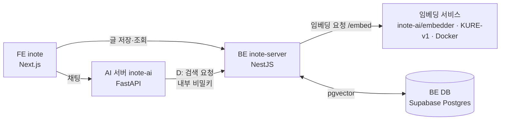

# KURE 임베딩 활용 — 기획·설계 (inote)

> 한국어 임베딩 모델 **KURE-v1**으로 내 글 사이의 "뜻이 비슷함"을 계산해서 관련 글 추천·카테고리 제안·중복 알림·내 글 기반 AI 답변(RAG)을 만든다.
> 상태: ✅ **방향 승인(2026-10-12)** — 코드 위치·로컬 DB 결정 완료, **A1 완료**, 다음은 A2 · 작성자: Claude Code
> 이 문서는 **한 단계씩** 구현한다. 아키텍처·UX는 AI가 임의로 정하지 않는다 → 아래 **「10. 결정과 미결정」**에서 아직 열려 있는 항목은 풀리기 전에는 해당 부분을 구현하지 않는다.
> 관련 레포: `inote`(FE) · `inote-server`(BE, 글·DB 소유) · `inote-ai`(AI 서버 + **`embedder/` 폴더에 임베딩 서비스**)

---

## 0. 한눈에

| 단계 | 내용 | 성격 | 선행 |
|---|---|---|---|
| **A. 기반** | 도커로 KURE 띄우기, 벡터 저장(pgvector), 글 저장 시 임베딩, 기존 글 일괄 계산, 공개 범위 규칙 | 보이지 않는 배관 | — |
| **B. 관련 글 추천** | 글 상세 하단 "비슷한 글" | 첫 눈에 보이는 결과 | A |
| **C. 카테고리 제안 · 유사 글 알림** | 글 저장·작성 중에 비슷한 글들의 카테고리를 제안, 비슷한 글이 있으면 알림 | 쓰는 중 모델을 불러야 함 | B |
| **D. 내 글 기반 답변 (RAG)** | AI 어시스턴트가 내 글을 찾아 출처와 함께 답변 | 가장 크고 위험 | C, 그리고 **AI 서버 요청자 검증(보안 과제)** |

**이 순서인 이유**: B·C는 모두 "어떤 글(또는 쓰는 중인 글)과 가장 비슷한 내 글 몇 개"라는 **같은 조회** 위에 있다. B를 만들면 C는 얇은 층만 더하면 된다. D는 글을 문단 단위로 쪼개고 LLM과 연결하는 별개의 큰 작업이라 앞 단계로 검증된 배관 위에서 한다. 검색(키워드→의미)은 D의 부산물이라 따로 만들지 않는다.

---

## 1. 배경과 목표

- 내 글이 쌓일수록 "전에 쓴 글을 다시 찾기·연결하기"가 어려워진다. 현재는 글자 일치 검색뿐이다.
- AI 어시스턴트는 내 글을 모른다 — 대화만 LLM에 보낸다.
- **목표**
  1. 글끼리 뜻으로 연결한다 (관련 글, 중복 감지).
  2. 글을 저장할 때 카테고리를 고르는 수고를 줄인다.
  3. AI 어시스턴트가 내 글을 근거로 답한다.
  4. (학습·포트폴리오) 한국어 임베딩·RAG를 **직접 측정해서** 고른 과정과 결과를 남긴다 — 감이 아니라 평가 세트로 기준을 정한다.
- 규모 현실: 공개 글이 약 20개뿐이라 서비스 가치보다 **설계·측정 경험의 가치**가 크다. 그래서 평가 계획(7절)을 기능만큼 중요하게 본다.

## 2. 현재 상태 (코드에서 확인한 사실)

| 항목 | 현재 |
|---|---|
| 글 저장 | BE(`inote-server`)의 `Post` — 본문 `content`는 **HTML**, `isPrivate`, `publishedAt`(null이면 draft), 카테고리는 이름 문자열 `category` + 트리(`PostCategory`) |
| 글 검색 | 제목·본문 글자 일치(대소문자 무시)만 |
| AI 채팅 | `inote-ai/app/routers/chat.py` — LLM(`openai/gpt-oss-20b`)에 시스템 프롬프트+대화만 전달. 글 본문·다른 글은 참조하지 않는다 (`post_id`·제목·카테고리는 저장·권한용) |
| 도구 호출 | `reading_chat.py`가 이미 OpenAI 방식 `tools`/`tool_choice="auto"`를 씀(`book_tools.py`) → D의 RAG를 **같은 방식의 도구**로 붙일 수 있다 |
| DB | **BE DB와 AI DB가 별개 Supabase 프로젝트.** 글·사용자는 BE DB. 모든 `public` 테이블에 **RLS 활성화**(Prisma 접속 사용자는 우회) |
| 외부 호출 패턴 | BE→AI는 `x-internal-secret` 헤더, 요약은 **실패해도 글 저장은 막지 않는(fail-open)** 패턴 |
| 로컬 환경 | **로컬 BE와 운영 BE가 같은 Supabase DB를 쓴다**(dev/prod 분리 없음). Docker Desktop **4.94.0 설치·확인됨**(2026-10-12). 이 PC는 **Intel Mac(x86_64)**, 컨테이너 자원 CPU 12 · 메모리 약 7.75GB, GPU 가속 없음(CPU 추론). 터미널 `docker` PATH 연결은 확인 필요(앱 안 실행 파일로는 동작) |
| 임베딩·벡터 코드 | 없음 |

## 3. 범위

**포함**: A~D 및 평가 세트.
**제외(이 문서에서는 다루지 않음)**: 이미지·표 의미 이해, 다국어 글, 사용자별 개인화 랭킹, 벡터 DB 전용 서비스(Pinecone 등) 도입, 모바일 앱 연동, 독서 기록과의 연결(후속 후보).

---

## 4. 전체 구조



- **임베딩 서비스**(신규): 텍스트 → 벡터만 하는 작은 서비스. 모델이 커서(수백 M 파라미터) BE·AI 서버와 분리한다.
- **BE가 벡터를 소유**한다: 글의 공개 여부·작성자와 같은 DB에서 **조인으로 거르기** 때문에 비공개 글이 새는 것을 구조적으로 막기 쉽다. AI 서버는 BE DB를 직접 읽지 않고(분리한 이유와 같다) **BE의 내부 검색 API**를 부른다.
- FE는 모델을 모른다. BE API만 부른다.

---

## 5. 공통 설계

### 5.1 모델
- **KURE-v1** (`nlpai-lab/KURE-v1`): 한국어 검색용으로 다듬은 임베딩 모델. BGE-M3 계열(다국어·긴 문맥)로 알고 있다.
- ⚠️ **구현 전에 모델 카드에서 확인할 것**: 벡터 차원(1024로 알고 있음), 최대 입력 길이, 라이선스, 질문/문서에 붙이는 접두어가 필요한지, 벡터가 이미 정규화되어 나오는지.
- 모델 이름·버전은 **DB에 같이 저장**한다(5.3) → 나중에 모델을 바꾸면 이전 벡터와 섞이지 않고 다시 계산할 대상을 알 수 있다.

### 5.2 임베딩 서비스 (embedder)

**계약 (제안)**
```
POST /embed          헤더: x-internal-secret
  요청  { "inputs": ["문장1", "문장2"] }        # 최대 16개, 각 최대 N자
  응답  { "model": "nlpai-lab/KURE-v1", "dim": 1024, "embeddings": [[...], [...]] }   # 정규화된 벡터
GET  /health         → { "status": "ok", "model": "...", "dim": 1024 }
```
- 인증은 기존 방식(`x-internal-secret` = BE·AI와 같은 `INTERNAL_SECRET`).
- 환경 변수 `EMBEDDER_URL`이 **없거나 응답이 없으면** BE는 임베딩을 **건너뛴다**(글 저장은 정상). 운영에 임베딩 서비스를 올리기 전에도 배포가 깨지지 않는다.

**구현 선택지**

| 안 | 내용 | 장점 | 단점 |
|---|---|---|---|
| **1안(권장)** | FastAPI + `sentence-transformers`로 직접 만든 작은 서비스를 도커 이미지로 | 모델 로드·배치·정규화를 직접 보며 **학습 가치**가 큼. 기존 파이썬·FastAPI 스택과 같음 | 이미지가 크다(수 GB), 직접 유지 |
| 2안 | Hugging Face **Text Embeddings Inference(TEI)** 공식 이미지 | 설정이 짧고 성능 최적화됨 | 이 PC는 Intel(amd64)이라 일반 이미지를 쓸 수 있어 호환 부담은 작지만 KURE(BGE-M3 계열) 지원은 **확인 필요**, 내부 동작이 블랙박스 |

→ 1안으로 시작, 지연·메모리를 측정한 뒤 필요하면 2안과 비교한다.
- **코드 위치 (확정): `inote-ai` 레포의 `embedder/` 폴더** — 새 레포를 만들지 않고 기존 파이썬 스택·문서·이력을 같이 쓰되, **배포는 별개**다.
  - ⚠️ **`.vercelignore`에 `embedder/`를 반드시 추가한다.** Vercel의 Python 함수는 프로젝트 파일을 전부 번들에 넣는다(이미 `venv/`·`.env`·문서를 제외하는 이유). 빼지 않으면 임베딩 코드·의존성 목록이 번들에 섞인다.
  - **루트 `requirements.txt`는 건드리지 않는다.** 무거운 의존성(`torch`, `sentence-transformers` 등)은 `embedder/requirements.txt`에만 둔다. 기존 앱(`app/`)에 `/embed` 라우터를 합치지 않는다 — Vercel 번들 크기 제한(비압축 500MB)·모델 로드 지연·기존 채팅·요약의 배포 속도 때문.
  - 인증(`x-internal-secret` 검사)은 몇 줄이라 `embedder/`에 따로 둔다. 나중에 호스팅할 때 이 폴더만 컨테이너로 올리고, 필요하면 그때 새 레포로 분리한다.
- 예상 성능(가설, A에서 측정): CPU 컨테이너에서 짧은 문장 1개에 수백 ms~수 초, 모델 메모리 약 2~3GB(이 PC의 도커 배정 7.75GB로 충분). **Render 무료(512MB)·Vercel 서버리스에는 올릴 수 없다** (8절).

### 5.3 저장 — Postgres `pgvector` (BE DB)

```sql
CREATE EXTENSION IF NOT EXISTS vector;          -- Supabase는 확장 스키마 위치 등 확인 필요

CREATE TABLE "PostEmbedding" (
  "postId"      TEXT PRIMARY KEY REFERENCES "Post"("id") ON DELETE CASCADE,
  "model"       TEXT NOT NULL,                    -- 'nlpai-lab/KURE-v1'
  "contentHash" TEXT NOT NULL,                    -- 임베딩한 텍스트의 해시: 같으면 다시 계산하지 않는다
  "embedding"   vector(1024) NOT NULL,            -- 차원은 모델 카드 확인 후 확정
  "embeddedAt"  TIMESTAMP(3) NOT NULL DEFAULT now()
);
ALTER TABLE "PostEmbedding" ENABLE ROW LEVEL SECURITY;   -- 프로젝트 규칙: 모든 public 테이블 RLS 켬
```
- 글 하나에 벡터 하나(글 단위). D에서 문단 단위 테이블(`PostChunkEmbedding`)을 **따로** 추가한다(필요해질 때 만든다).
- 거리는 **코사인**(`<=>`). 글이 수백 개 이하이면 **인덱스 없이 전체 비교**로 충분하다(정확하고 단순). 수천 개를 넘기면 HNSW 인덱스를 검토.
- 공개 여부·작성자는 **복사해 두지 않고** `Post`와 조인해서 조회 시점에 거른다(비공개로 바꿔도 벡터를 건드릴 필요가 없고, 값이 어긋날 일이 없다).
- Prisma는 `vector` 타입을 기본 지원하지 않는다 → 스키마에 `Unsupported("vector(1024)")`로 두고 **유사도 조회는 `$queryRaw`**. 마이그레이션은 SQL을 직접 쓴다.

### 5.4 임베딩할 텍스트 만들기
- `제목 + 줄바꿈 + 본문 텍스트`: HTML 태그를 지우고 공백을 정리한 순수 텍스트. 코드 블록은 일단 포함하되 길이 상한으로 자른다.
- **카테고리는 텍스트에 넣지 않는다** — C에서 카테고리를 예측하는데 정답이 입력에 섞이면 안 된다.
- 길이 상한(예: 앞 N자)은 지연과 품질을 측정해서 정한다 (제안: 처음엔 제목+앞부분 약 1,500자).
- 같은 텍스트면 같은 해시 → 재계산 생략.

### 5.5 갱신 정책
| 이벤트 | 동작 |
|---|---|
| 글 발행/재저장(`publish: true`) | 저장 응답은 막지 않고 **뒤에서** 임베딩(실패하면 경고 로그만, fail-open). 해시가 같으면 생략 |
| 자동 임시저장 | 하지 않음 (draft는 대상 아님) |
| 공개↔비공개 전환 | 벡터는 그대로. 조회 시 조인으로 거른다 |
| 글 삭제 | `ON DELETE CASCADE`로 같이 삭제 |
| 모델 교체 | `model` 컬럼이 다른 행을 일괄 재계산 (백필 스크립트 재사용) |
| 기존 글 | **백필 스크립트**로 한 번에 계산 (발행된 모든 글) |

### 5.6 공개 범위 규칙 (가장 중요 — 어기면 비공개 글 유출)

| 기능 | 후보 글 |
|---|---|
| B 관련 글 (읽는 사람 화면) | 발행됨 **AND** (공개 **OR** 요청자 본인 글) — 글 상세 조회 규칙과 같다 |
| C 카테고리 제안·유사 글 알림 (쓰는 사람 화면) | **요청자 본인의 발행 글만**(비공개 포함). 남의 글은 쓰지 않는다 |
| D RAG | 게스트: 공개 글만 / 로그인: 공개 글 + 본인 글. ⚠️ **AI 서버 요청자 검증 전에는 본인 비공개 글을 검색하지 않는다**(6절 D) |

- 규칙은 **하나의 조회 함수**에 모아서 B·C·D가 같은 걸 쓰게 한다 (흩어지면 하나가 빠진다).
- 접근 불가 글은 응답에 **존재 자체를 드러내지 않는다**(제목·개수도 없음).

### 5.7 장애·성능
- 임베딩 서비스 장애 시: B는 "비슷한 글" 영역을 숨기고(이미 계산된 벡터로는 조회 가능), C는 제안을 숨기고, D는 도구 없이 일반 답변. **글쓰기·저장은 절대 막히지 않는다.**
- 쓰는 중 호출(C)은 입력이 멈춘 뒤에만(디바운스), 최소 글자 수, 이전 요청 취소, 서버 쪽 호출 빈도 제한.

---

## 6. 단계별 설계

> 진행 규칙: **계약 → FE(유닛·MSW 테스트) → BE → 통합 확인**, 한 번에 한 작업, 끝날 때마다 보고. BE 테스트는 Claude가 목록·골격을 주고 사용자가 작성(미루면 spec 주석으로 남김).

### A. 기반
**목표**: 내 글이 벡터로 저장되고, "가까운 이웃"을 SQL로 확인할 수 있다. 화면 변화는 없다.

**도커가 하는 일 (두 가지)**
1. **임베딩 서비스 컨테이너** (KURE 서빙)
2. **로컬 개발용 Postgres + pgvector 컨테이너 (확정)** — 지금은 로컬 BE가 운영 DB를 같이 써서 `migrate`·실험이 운영에 바로 영향을 준다(HANDOFF 주의 사항). **새 테이블·확장은 로컬 DB에서 먼저 검증**하고, 확인되면 운영에 마이그레이션한다. 로컬 DB에는 **공개 API로 가져온 공개 글만** 넣는다(비공개 글을 복사하지 않는다).

**작업**
| # | 작업 | 담당 |
|---|---|---|
| A1 | ✅ Docker Desktop 설치·확인 (2026-10-12: 4.94.0, Intel Mac, 배정 CPU 12·메모리 7.75GB) | 사용자·Claude |
| A2 | 임베딩 서비스(`inote-ai/embedder/`): 모델 로드, `/embed`·`/health`, Dockerfile, `.vercelignore` 갱신, 로컬 실행. **측정**: 첫 로드 시간, 메모리, 문장당 지연. **눈으로 확인**: 비슷한 문장 쌍 vs 무관한 쌍의 유사도 | Claude |
| A3 | 로컬 pgvector Postgres 컨테이너 + 로컬 BE 연결 설정(`.env`, 운영 DB와 분리) + 공개 글 가져오기 | Claude |
| A4 | 마이그레이션(`PostEmbedding` + RLS) — **로컬에서 먼저 적용** | Claude |
| A5 | BE `EmbeddingService`(텍스트 만들기·해시·`/embed` 호출·저장) + 발행 훅(fail-open) + `EMBEDDER_URL` | Claude(BE 테스트: 사용자) |
| A6 | 백필 스크립트 + "가장 가까운 글 5개" 확인용 쿼리 | Claude |
| A7 | **평가 세트 v0**: 질문↔정답 글, 비슷한/무관한 글 쌍을 사람이 표시 (7절) | 사용자 |

**완료 기준**: ① 컨테이너에서 한국어 문장이 임베딩되고 시간·메모리가 기록됨 ② 글을 저장하면 벡터가 생기고 재저장해도 내용이 같으면 재계산 안 함 ③ 백필 후 임의의 글의 가까운 이웃이 사람 눈에 납득됨 ④ 임베딩 서비스를 끄고 글을 저장해도 정상.
**위험**: 이미지 크기·첫 로드 지연 / Supabase의 `vector` 확장 사용법 / Prisma `Unsupported` 타입의 마이그레이션.

### B. 관련 글 추천
**계약 (제안)**
```
GET /blog/posts/:id/similar?limit=5        (로그인 선택)
  → { items: [{ id, title, category, categoryPath, excerpt, user: {name}, score }] }
```
- 후보: 5.6의 B 규칙. 자기 자신 제외. 유사도 **최소 기준(τ_min)** 미만이면 내려주지 않는다(억지 추천 방지, 값은 평가로 정함).
- 글 접근 권한이 없으면 기존 상세와 같이 404, 이 글의 벡터가 아직 없으면 빈 목록.
**FE**: 글 상세 본문 아래 "비슷한 글" 영역(제목 링크, 카테고리 경로). 비면 영역 자체를 그리지 않는다. 캐시는 글 단위.
**테스트**: 비공개·남의 글 비노출, 본인 글 포함 규칙, 자기 제외, 기준 미달 제외, 벡터 없는 글.
**완료 기준**: 실제 글에서 추천이 사람 눈에 납득됨, 비공개 글이 비로그인 화면에 절대 안 나옴(조회로 확인).

### C. 카테고리 제안 · 유사 글 알림
**계약 (제안)** — 저장 전의 글(아직 DB에 없는 텍스트)을 받으므로 **쓰는 중에 임베딩 서비스를 직접 호출**한다.
```
POST /blog/posts/suggestions         (로그인 필수)
  요청  { title, content, postId? }                  # postId: 수정 중인 글이면 후보에서 제외
  응답  { categories: [{ name, path, score }],        # 제안 카테고리 (최대 3)
          similarPosts: [{ id, title, score }] }      # 거의 같은 글 (기준 이상일 때만)
```
- 후보: **요청자 본인의 발행 글만**(비공개 포함).
- **카테고리 제안**: 가장 가까운 k개(제안 k=5)의 카테고리를 **유사도 가중 투표**. 이웃이 너무 적거나 점수가 낮으면 제안하지 않는다.
- **유사 글 알림**: 최상위 유사도가 **중복 기준(τ_dup) 이상**일 때만.
- 입력 텍스트도 5.4와 같은 방식으로 만든다(카테고리 제외).
**FE (UX 승인 필요 — 10절)**: 글 저장 설정 영역(`WriteSidePanel`)에 **추천 카테고리 칩**(누르면 선택), 글쓰기 중 **"비슷한 글이 있어요" 알림**(새 탭 링크). 입력이 멈춘 뒤 호출, 최소 글자 수, 이전 요청 취소.
**테스트**: 본인 글만 후보, 남의 글·비공개 노출 없음, 수정 중인 글 자신 제외, 빈약한 이웃이면 제안 없음, 임베딩 서비스 장애 시 빈 응답(오류 아님), 호출 빈도 제한.
**완료 기준**: 평가 세트에서 제안 정확도가 기준(예: 1순위 적중률)을 넘음, 중복 알림의 정밀도가 기준을 넘음(7절).

### D. 내 글 기반 답변 (RAG)
**선행 조건 (필수)**: AI 서버가 FE가 보낸 `user_id`를 그대로 믿는 문제(HANDOFF 「보안·설계 과제」). 이대로 "내 글 검색"을 붙이면 **user_id를 위조해 남의 비공개 글을 읽을 수 있다.** → 요청자 검증(예: BE가 짧은 수명 토큰 발급 / AI가 세션 직접 검증)을 **먼저** 풀거나, 풀기 전에는 **공개 글만 검색**한다.

**설계**
1. **문단 단위 임베딩**: HTML을 제목·문단 경계로 잘라 약 300~500 토큰(약간 겹침) 조각으로 `PostChunkEmbedding(postId, idx, text, embedding, …)` 저장. 조각 텍스트를 같이 저장해 **출처 표시**에 쓴다.
2. **BE 내부 검색 API**(AI 서버 전용, `x-internal-secret`): `POST /internal/retrieval/search { userId|null, query, k }` → `[{ postId, title, url, chunkText, score }]`. 후보는 5.6 D 규칙.
3. **AI 서버 도구**: 독서 채팅의 `book_tools`와 같은 방식으로 `search_my_posts` 도구를 추가. 모델이 필요하다고 판단할 때만 호출(`tool_choice="auto"`).
4. **답변 규칙**: 근거 조각이 있으면 **출처 링크와 함께** 답하고, 없으면 "관련 글을 찾지 못했다"고 말한다(지어내지 않기).
5. **FE**: 답변 안의 출처 링크 표시(필요하면 "출처" 칩).
**평가**: 질문 세트로 검색 적중률(Recall@k)과 답변의 출처 정확성을 본다 (7절).
**위험**: 조각 크기·겹침 설정에 따른 품질 편차 / 모델이 도구를 안 부르거나 과호출 / LLM 지연 증가(검색+생성) / 위 보안 과제.

---

## 7. 평가 계획 (측정해서 기준을 정한다)

| 무엇 | 방법 | 쓰임 |
|---|---|---|
| **검색 평가 세트** | 내 글에서 질문 20~30개 + 정답 글 id를 사람이 작성 (`docs/kure/eval/` 아래 JSON) | B·D 품질, 모델/길이 설정 비교 |
| **유사 쌍 라벨** | "비슷함/아님" 쌍 30개를 사람이 표시 | **τ_min, τ_dup 기준값 선택** (정밀도 우선) |
| **카테고리 검증** | 발행된 글 각각을 **자기 자신 제외**하고(leave-one-out) 제안 → 실제 카테고리와 비교 | C의 제안 정확도 |
| **기준선** | 현재의 글자 일치 검색(ILIKE)과 비교 | "임베딩이 실제로 더 낫나"의 근거 |
| (선택) 모델 비교 | KURE vs 다른 다국어 임베딩 모델 | KURE를 고른 근거 |

- 지표: Recall@3/5, MRR, 정밀도/재현율. 평가 세트는 작아서(20~30) 숫자의 **의미를 과대 해석하지 않고**, 어디서 틀렸는지 사례를 같이 본다.
- 결과는 블로그 글·포트폴리오로 이어질 수 있게 `docs/kure/`에 기록한다.

## 8. 배포 계획

1. **1차: 로컬(도커)에서만** A→B를 끝내고 화면으로 확인한다. 이때 운영 BE는 `EMBEDDER_URL`이 없어 임베딩을 건너뛴다(기능은 숨겨짐).
2. **운영 반영 순서**: ① 마이그레이션(`vector` 확장 + 테이블) 먼저 배포 ② 임베딩 서비스를 호스팅 ③ `EMBEDDER_URL` 설정 ④ 백필 ⑤ FE 배포. (DB 변경을 먼저 배포하는 기존 규칙과 같다)
3. **임베딩 서비스 호스팅 후보 (미결정)** — 모델이 커서 Render 무료·Vercel에는 불가:
   - Hugging Face Spaces(Docker, 무료 CPU 등급이 있는 것으로 알고 있음 — 사양·제한 **확인 필요**)
   - Google Cloud Run 등 컨테이너 서비스(0으로 줄이면 첫 요청에 모델 로드 지연)
   - Fly.io 등 소규모 VM
   - 호스팅된 추론 API 사용(비용·한도 확인)
   - **무료 서비스는 공식 요금 페이지·가입 화면으로 조건을 먼저 확인한다**(이전 사례 교훈).
4. 호스팅이 정해지기 전에는 C(쓰는 중 호출)는 **로컬에서만 동작**한다.

## 9. 진행 체크리스트

- [x] **0. 방향 승인** + 코드 위치(`inote-ai/embedder/`)·로컬 DB 도커 분리 결정 (2026-10-12)
- [ ] **A. 기반** — [x] A1 도커 설치 · [ ] A2 임베딩 서비스 · [ ] A3 로컬 DB · [ ] A4 마이그레이션 · [ ] A5 BE 임베딩 · [ ] A6 백필 · [ ] A7 평가 세트 v0
- [ ] **B. 관련 글 추천** — [ ] 계약 확정 · [ ] FE · [ ] BE · [ ] 통합 확인
- [ ] **C. 카테고리 제안·유사 글 알림** — [ ] UX 승인 · [ ] 계약 확정 · [ ] FE · [ ] BE · [ ] 통합 확인 · [ ] 기준값 측정
- [ ] **D. RAG** — [ ] 요청자 검증 과제 해결(또는 공개 글만) · [ ] 청크 설계 확정 · [ ] BE 검색 API · [ ] AI 도구 · [ ] FE 출처 · [ ] 평가

각 단계가 끝날 때마다 `HANDOFF.md`를 갱신하고, 커밋·푸시는 요청할 때만 한다.

## 10. 결정과 미결정

| # | 항목 | 현재 제안 | 결정 시점 |
|---|---|---|---|
| 1 | 임베딩 서비스 코드 위치 | ✅ **확정: `inote-ai/embedder/` 폴더** (`.vercelignore`에 `embedder/` 추가 필수) | 2026-10-12 |
| 2 | 임베딩 서비스 구현 | 1안(FastAPI+sentence-transformers), 측정 후 TEI와 비교 | A2 |
| 3 | 모델 카드 확인 항목(차원·최대 길이·라이선스·접두어·정규화) | 구현 전 확인 | A2 |
| 4 | 로컬 개발 DB를 도커 Postgres로 분리 | ✅ **확정** (운영 DB 보호, 공개 글만 가져옴) | 2026-10-12 |
| 5 | 운영의 `vector` 확장 사용 가능 여부(Supabase 무료) | 확인 필요 | 운영 반영 전 |
| 6 | 임베딩 텍스트 길이 상한 | 제목+앞 약 1,500자에서 시작해 측정 | A2·A6 |
| 7 | C의 UX(칩 위치, 알림 모양, 자동/수동 호출) | 저장 설정 영역에 칩, 알림은 배너 | C 시작 전, **사람 승인** |
| 8 | τ_min, τ_dup, k | 평가 세트로 정함 | B·C |
| 9 | 운영 호스팅 | 미정 (8절 후보) | B 완료 후 |
| 10 | D의 요청자 검증 방식 | 후보: BE 토큰 발급 / AI가 세션 직접 검증 | D 전, **사람 승인** |

## 11. 위험과 대응

| 위험 | 영향 | 대응 |
|---|---|---|
| **비공개 글 유출** | 심각 | 후보 규칙을 한 함수로 통일(5.6), 조인으로 거르기, 비로그인·타인 계정으로 조회 테스트, D는 요청자 검증 전 공개 글만 |
| 로컬 작업이 운영 DB를 건드림 | 높음 | A3에서 로컬 도커 DB로 분리, 운영 마이그레이션은 마지막 |
| 모델이 커서 호스팅이 어려움 | 중 | 로컬 우선, 호스팅은 B 이후 결정, 장애 시 기능만 숨기는 fail-open |
| 글이 적어 품질·기준값을 믿기 어려움 | 중 | 평가 세트의 한계를 명시하고 사례 중심으로 본다, 기준값은 보수적으로(정밀도 우선) |
| 쓰는 중 호출의 지연·비용 | 중 | 디바운스·최소 길이·취소·빈도 제한, 실패 시 조용히 생략 |
| 모델 교체 시 벡터 혼재 | 낮음 | `model` 컬럼 + 재계산 스크립트 |
| `embedder/`가 Vercel 번들에 섞임 | 중 (배포 크기·속도) | `.vercelignore`에 `embedder/` 추가, 루트 `requirements.txt` 불변, 배포 후 번들 크기 확인 |

---

## 부록. 용어
- **임베딩**: 글을 뜻이 비슷하면 가까워지는 숫자 벡터(여기서는 1024개 숫자로 알고 있음)로 바꾼 것.
- **코사인 유사도/거리**: 두 벡터가 얼마나 같은 방향인지. 1에 가까울수록 비슷(거리는 0에 가까울수록).
- **pgvector**: Postgres에 벡터 타입과 가까운 이웃 조회를 더해 주는 확장.
- **top-k**: 가장 비슷한 k개.
- **청크(chunk)**: 긴 글을 검색 단위로 쪼갠 조각. **RAG**: 검색한 조각을 LLM에 근거로 주고 답하게 하는 방식.
- **fail-open**: 부가 기능이 실패해도 핵심 기능(글 저장)은 막지 않는 방식.
